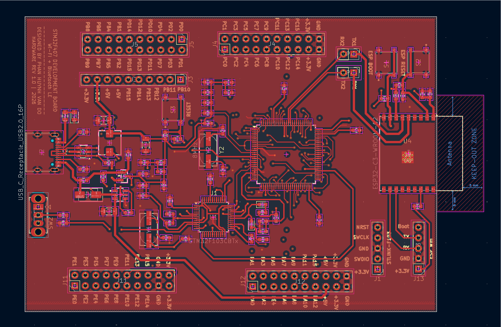
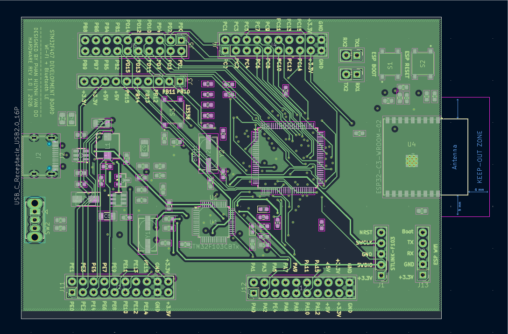
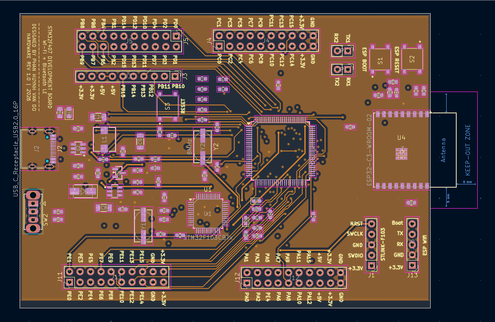
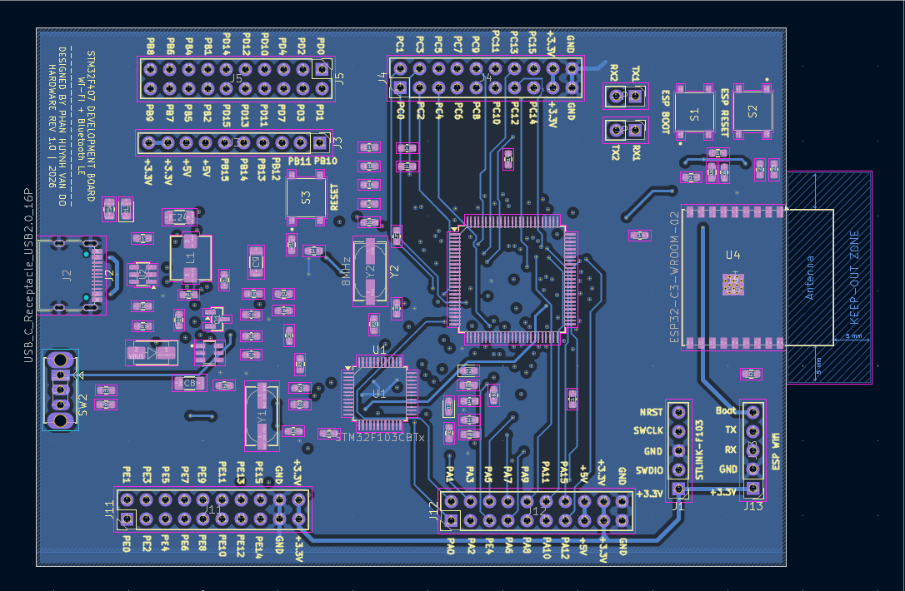
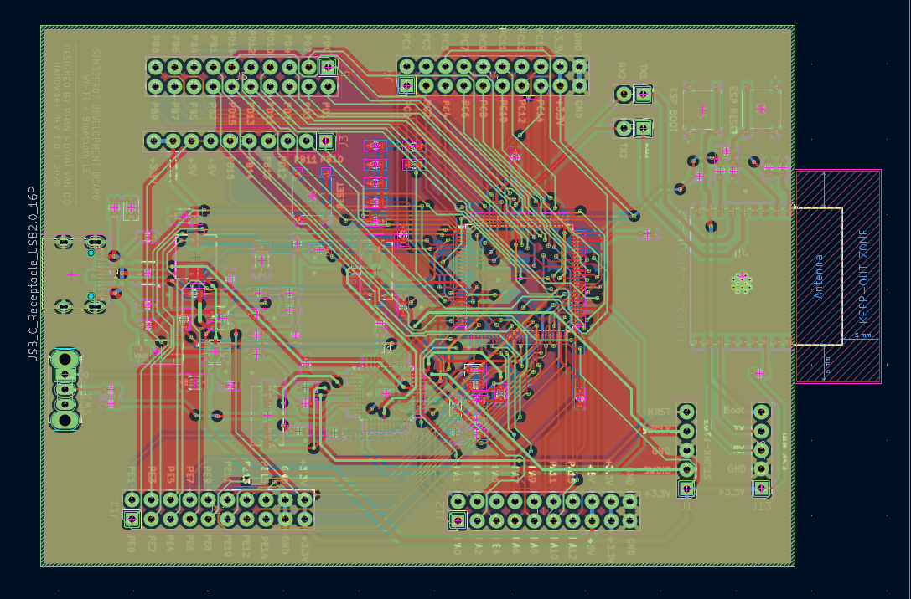
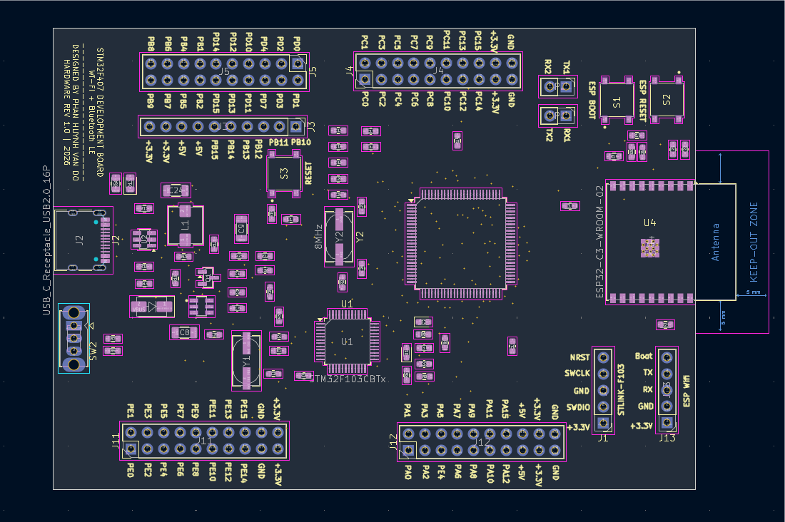
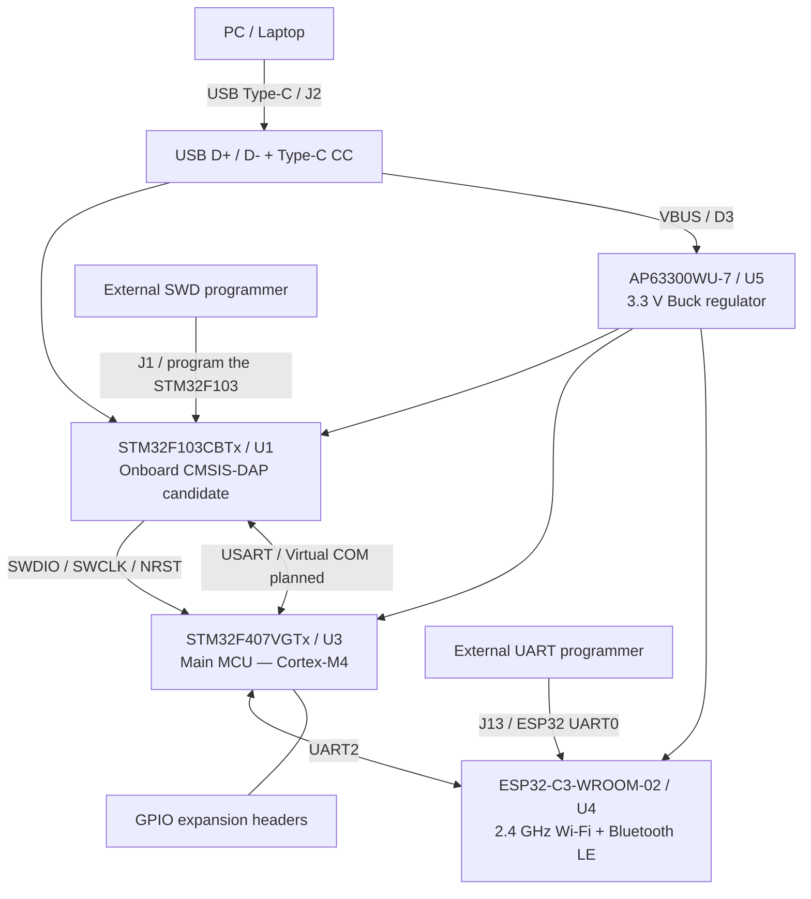

# STM32F407VGTx Connect — Wi-Fi & Bluetooth LE Development Board

**4-Layer PCB | KiCad 10 | STM32F407 + STM32F103 + ESP32-C3**

**Custom STM32 development board** based on the **STM32F407VGTx (ARM Cortex-M4)**, designed in **KiCad 10** with an **STM32F103CBTx onboard debug-probe circuit**, **USB Type-C**, **ESP32-C3 Wi-Fi/Bluetooth LE**, a **3.3 V / 3 A buck regulator**, and GPIO expansion headers.


> [!IMPORTANT]
> **Trạng thái dự án:** Repository chứa **schematic, PCB 4 lớp, hình ảnh 3D, Gerber/Drill, BOM, dữ liệu placement, thư viện AP63300WU-7 và mã nguồn firmware debug tham khảo**. Các file đã được thiết kế/xuất từ KiCad; **chưa có bằng chứng bo đã được lắp ráp và thử nghiệm thực tế**, cũng chưa có báo cáo ERC/DRC được xác minh kèm theo.
>
> **`firrmware_STLINKV2/` chứa mã nguồn [dap42](https://github.com/devanlai/dap42) (CMSIS-DAP nguồn mở), KHÔNG phải firmware ST-LINK/V2 chính hãng.** Không được mặc định rằng firmware tham khảo sẽ chạy ngay trên bo tự thiết kế nếu chưa kiểm tra chân MCU, USB và clock.

## 1. PCB 3D Preview

### Tổng quan bo mạch

[](Images/board_3D%281%29.png)

### Hai góc nhìn 3D bổ sung

| 3D View 01 — Top View | 3D View 02 — Perspective View |
| :---: | :---: |
| [](Images/board_3D%282%29.png) | [](Images/board_3D%283%29.png) |

> **Lưu ý:** Cả ba ảnh là bản dựng 3D từ KiCad, chưa phải ảnh bo mạch đã gia công hoặc lắp ráp. Nhấn vào từng ảnh để mở bản gốc.

## 2. PCB Layout — 4 Copper Layers

Bo mạch được thiết kế với **bốn lớp đồng**: `F.Cu`, `In1.Cu`, `In2.Cu`, `B.Cu`. Các hình dưới đây được lấy trực tiếp từ thư mục [`Images/`](Images/) trong project.

| Front Copper — `F.Cu` | Inner Copper 1 — `In1.Cu` |
| :---: | :---: |
| [](Images/F_cu.png) | [](Images/in1.png) |

| Inner Copper 2 — `In2.Cu` | Back Copper — `B.Cu` |
| :---: | :---: |
| [](Images/in2.png) | [](Images/B_cu.png) |

### Toàn bộ các lớp đồng

[](Images/ALL_layers.png)

### Bố trí footprint

[](Images/footprint.png)

> [!NOTE]
> Ảnh các lớp và tập tin sản xuất là **kết quả xuất thiết kế**. Chúng chưa chứng minh các đường tín hiệu đã qua kiểm tra SI/EMC, ERC/DRC hoặc kiểm thử phần cứng.

## 3. System Architecture



Đây là **kiến trúc phần cứng dự kiến**. Các chức năng CMSIS-DAP, Virtual COM và Wi-Fi/BLE chỉ hoạt động sau khi có firmware đúng và kiểm thử trên bo thực tế.

## 4. Hardware Overview

| Khối | Linh kiện / đầu nối thực tế | Vai trò |
| --- | --- | --- |
| Main MCU | **U3 — STM32F407VGTx** | MCU ARM Cortex-M4, chạy ứng dụng chính |
| Debug MCU | **U1 — STM32F103CBTx** | Phần cứng debug probe tích hợp, dự kiến dùng CMSIS-DAP |
| Wireless | **U4 — ESP32-C3-WROOM-02** | Wi-Fi 2.4 GHz, Bluetooth Low Energy (BLE) |
| USB | **J2 — USB-C 2.0 (16 chân)** | USB dữ liệu và cấp nguồn đầu vào |
| USB ESD | **U2 — USBLC6-2SC6** | Bảo vệ ESD cho USB D+/D− |
| Power converter | **U5 — AP63300WU-7**, **L1 — 4.7 µH** | Buck 5 V sang 3.3 V, IC có định mức đầu ra tới 3 A |
| Reverse-current blocking | **D3 — SS34** | Diode Schottky trên đường cấp nguồn USB |
| Clocks | **Y1, Y2 — 8 MHz** | HSE riêng cho STM32F103 và STM32F407 |
| GPIO expansion | **J3, J4, J5, J11, J12** | Các chân mở rộng thể hiện trong project |
| Debug-MCU programming | **J1 — 1×5 header** | Nạp/khôi phục STM32F103 bằng SWD ngoài |
| ESP32 programming | **J13 — 1×5 header** | Đầu nối UART0 của ESP32-C3 |
| UART jumpers | **JP1, JP2** | Cho phép ngắt/nối UART giữa STM32F407 và ESP32 |
| User controls | **S1, S2, S3, SW2** | Các nút nhấn và công tắc theo schematic |
| Custom library | **`library/AP63300WU-7/`** | Symbol, footprint và mô hình STEP của U5 |

### Nguồn hệ thống

Nguồn USB đi qua **D3 (SS34)**; **AP63300WU-7** tạo đường **3.3 V** cho các mạch trên bo. Thiết kế Buck có **L1 = 4.7 µH**, tụ bootstrap, cầu chia áp FB và các tụ lọc đầu vào/đầu ra.

> [!WARNING]
> **3 A là định mức đầu ra của IC Buck, không phải mức dòng mà mọi cổng USB-C máy tính cho phép lấy.** Dòng khả dụng phụ thuộc nguồn USB, điện trở CC, dây cáp, bảo vệ quá dòng và tải thực tế. Cần kiểm tra dòng đỉnh của ESP32-C3, nhiệt độ linh kiện và khả năng cấp nguồn trước khi khai thác toàn bộ tải.
>
> USBLC6-2SC6 bảo vệ **xung ESD**; nó **không thay thế** thiết bị giới hạn quá dòng liên tục trên VBUS.

### HSE và RTC

- **Y1 = 8 MHz:** nguồn HSE dự kiến cho STM32F103.
- **Y2 = 8 MHz:** HSE của STM32F407, nối với **PH0/OSC_IN** và **PH1/OSC_OUT**.
- Các tụ tải được thể hiện trong schematic; giá trị cuối cần đối chiếu datasheet của đúng mã thạch anh và ký sinh layout.
- Thiết kế không sử dụng thạch anh RTC/LSE ngoài 32.768 kHz.

## 5. STM32 Programming, Debugging & UART

### A. Onboard debug path

Đường debug được thiết kế như sau:

`PC → J2 USB-C → U1 STM32F103 → SWD → U3 STM32F407`

| Chức năng | STM32F103 (U1) | STM32F407 (U3) |
| --- | --- | --- |
| SWDIO | PB14 | PA13 |
| SWCLK | PB13 | PA14 |
| Target reset | PB0 | NRST |
| UART đến MCU chính | PA2 / USART2_TX | PD9 / USART3_RX |
| UART từ MCU chính | PA3 / USART2_RX | PD8 / USART3_TX |

**Chân U1, U3 và tên net cần được đối chiếu trong bản schematic đang phát hành** trước khi thay đổi firmware hoặc PCB. Các đường SWD/UART được thiết kế cho chức năng debug và Virtual COM, **không có nghĩa thiết bị đã được nhận là ST-LINK trên PC**.

### B. First-time programming of debug MCU

**J1 là header dùng để nạp chính U1 (STM32F103)** theo BOM của project. Khi STM32F103 mới chưa có firmware, cần **probe SWD bên ngoài** để nạp firmware probe lần đầu. Không nhầm J1 với cổng debug mặc định của STM32F407.

### C. ESP32-C3 UART

Sơ đồ dành hai đường UART giữa MCU chính và ESP32-C3, qua **JP1/JP2**:

| STM32F407 | ESP32-C3 | Hướng tín hiệu |
| --- | --- | --- |
| PD5 / USART2_TX | GPIO6 (RX do firmware cấu hình) | STM32 → ESP32 |
| PD6 / USART2_RX | GPIO7 (TX do firmware cấu hình) | ESP32 → STM32 |

Đóng JP1/JP2 để nối UART. Trên ESP32-C3, UART có thể gán qua GPIO Matrix; firmware phải cấu hình đúng chân, điện áp logic **3.3 V**, tốc độ baud và giao thức.

## 6. Debugger Firmware — dap42 / CMSIS-DAP

Mã nguồn đi kèm được lưu tại [`firrmware_STLINKV2/`](firrmware_STLINKV2/). **Tên thư mục được giữ đúng như trong project, kể cả cách viết `firrmware`.**

> [!IMPORTANT]
> Đây là mã nguồn **[dap42](https://github.com/devanlai/dap42)** cho CMSIS-DAP, **không phải firmware ST-LINK/V2 chính thức**. Dự án dap42 có nhiều cấu hình STM32F103 cho các bo khác nhau. Cần sửa/đối chiếu chân debug, USB RENUM, LED, HSE và UART với phần cứng của project này trước khi sử dụng.

### Nội dung firmware hiện có

| Đường dẫn | Nội dung |
| --- | --- |
| [`firrmware_STLINKV2/src/`](firrmware_STLINKV2/src/) | Mã nguồn CMSIS-DAP, USB và cấu hình MCU |
| [`firrmware_STLINKV2/src/targets.mk`](firrmware_STLINKV2/src/targets.mk) | Danh sách build target |
| [`firrmware_STLINKV2/Makefile`](firrmware_STLINKV2/Makefile) | Hệ thống build |
| [`firrmware_STLINKV2/openocd/`](firrmware_STLINKV2/openocd/) | Ví dụ cấu hình OpenOCD |
| [`firrmware_STLINKV2/FLASHING.md`](firrmware_STLINKV2/FLASHING.md) | Hướng dẫn nạp firmware từ upstream |
| [`firrmware_STLINKV2/LICENSE`](firrmware_STLINKV2/LICENSE) | Giấy phép nguồn firmware |

### Biên dịch firmware tham khảo (Ubuntu)

Bản RAR **chưa có mã nguồn trong `firrmware_STLINKV2/libopencm3/`**; cần bổ sung dependency trước khi build.

```bash
sudo apt update
sudo apt install git make gcc-arm-none-eabi binutils-arm-none-eabi

cd firrmware_STLINKV2
# Chỉ thực hiện nếu thư mục libopencm3 đang trống
 git clone https://github.com/libopencm3/libopencm3.git libopencm3

# Ví dụ build cho profile STM32F103 Blue Pill của dap42:
make DAP103-BLUEPILL.bin
```

> [!CAUTION]
> **Không nạp thẳng file `DAP103-BLUEPILL.bin` lên U1 của PCB này** trước khi đối chiếu `src/stm32f103/bluepill/target.c`, `config.h`, mạch điều khiển USB pull-up `RENUM` và UART. Đây mới là ví dụ về **cách build target có sẵn**, không phải firmware đã tùy biến và kiểm chứng cho bo STM32F407 Wi-Fi/BLE.

Tham khảo thêm: [dap42 upstream](https://github.com/devanlai/dap42) · [libopencm3](https://github.com/libopencm3/libopencm3) · [OpenOCD](https://openocd.org/).

## 7. ESP32-C3 Wi-Fi & Bluetooth LE

**ESP32-C3-WROOM-02 (U4)** cung cấp kết nối **Wi-Fi 2.4 GHz và Bluetooth Low Energy**. ESP32-C3 **không hỗ trợ Bluetooth Classic**.

- **J13 (`ESP32_UART0_PROG`)**: chân UART0 phục vụ nạp và kiểm tra module.
- **JP1/JP2**: cầu nối UART với STM32F407.
- Dữ liệu qua Wi-Fi/BLE cần firmware riêng cho ESP32-C3; **project RAR hiện không chứa firmware ứng dụng hoàn chỉnh cho U3 hoặc U4**.
- Khi bố trí anten ESP32-C3 phải tuân thủ vùng keep-out, không đổ đồng hoặc đặt kim loại vào khu vực cấm theo tài liệu module.

## 8. Project Structure

```text
STM32F407VGTx_wifi/
├── README.md
├── STM32F407VGTx_wifi.kicad_pro      # KiCad project
├── STM32F407VGTx_wifi.kicad_sch      # Full schematic
├── STM32F407VGTx_wifi.kicad_pcb      # 4-layer PCB
├── schematic.pdf                     # PDF schematic
├── Images/
│   ├── board_3D(1).png              # 3D top view
│   ├── board_3D(2).png              # 3D isometric view
│   ├── board_3D(3).png              # 3D supplementary view
│   ├── F_cu.png                     # Front copper
│   ├── in1.png                      # Inner copper layer 1
│   ├── in2.png                      # Inner copper layer 2
│   ├── B_cu.png                     # Back copper
│   ├── ALL_layers.png               # All layers overview
│   └── footprint.png                # Component placement
├── production/
│   ├── STM32F407VGTx_wifi.zip       # Gerber + drill files (4 layers)
│   ├── bom.csv                      # Bill of materials
│   ├── positions.csv                # Component positions
│   ├── designators.csv              # Designator list
│   └── netlist.ipc                  # IPC netlist
├── library/
│   └── AP63300WU-7/                 # Custom symbol, footprint and STEP
│       ├── AP63300WU-7.kicad_sym
│       ├── SOT95P280X100-6N.kicad_mod
│       └── AP63300WU-7.step
└── firrmware_STLINKV2/              # Upstream dap42 CMSIS-DAP source
    ├── src/
    ├── openocd/
    ├── drivers/
    ├── Makefile
    ├── FLASHING.md
    ├── LICENSE
    └── README.md
```

> `Images/` dùng **chữ I viết hoa**; tên `in1.png` và `in2.png` cũng viết thường như trong RAR. GitHub phân biệt chữ hoa/chữ thường trong đường dẫn.

### Quick Links

| Tài nguyên | Liên kết |
| --- | --- |
| KiCad PCB | [STM32F407VGTx_wifi.kicad_pcb](STM32F407VGTx_wifi.kicad_pcb) |
| KiCad schematic | [STM32F407VGTx_wifi.kicad_sch](STM32F407VGTx_wifi.kicad_sch) |
| Schematic PDF | [schematic.pdf](schematic.pdf) |
| Gerber + Drill ZIP | [production/STM32F407VGTx_wifi.zip](production/STM32F407VGTx_wifi.zip) |
| BOM | [production/bom.csv](production/bom.csv) |
| Placement | [production/positions.csv](production/positions.csv) |
| Full images | [Images/](Images/) |
| CMSIS-DAP firmware source | [firrmware_STLINKV2/](firrmware_STLINKV2/) |
| AP63300WU-7 library | [library/AP63300WU-7/](library/AP63300WU-7/) |

### Mở project trên KiCad 10

1. Tải/clone repository rồi giữ nguyên cấu trúc thư mục.
2. Mở file `STM32F407VGTx_wifi.kicad_pro` bằng **KiCad 10**.
3. Kiểm tra và khai báo thư viện tùy chỉnh **AP63300WU-7** nếu KiCad báo không tìm thấy symbol/footprint.
4. Mở Schematic Editor → **Inspect → Electrical Rules Checker (ERC)**.
5. Mở PCB Editor → **Inspect → Design Rules Checker (DRC)**, kiểm tra lại netlist và quy tắc sản xuất trước khi xuất Gerber mới.

## 9. Verification Checklist

- [x] Có project KiCad 10 và schematic đầy đủ.
- [x] Có PCB **4 lớp đồng** `F.Cu`, `In1.Cu`, `In2.Cu`, `B.Cu`.
- [x] Có ba ảnh 3D, bốn ảnh lớp đồng, ảnh tổng hợp và footprint.
- [x] Có tập tin Gerber, drill, BOM, component positions và IPC netlist.
- [x] Có thiết kế STM32F407VGTx, STM32F103CBTx, ESP32-C3 và nguồn AP63300WU-7.
- [x] Có IC USBLC6-2SC6 bảo vệ ESD ở đường USB.
- [x] Có mã nguồn dap42/CMSIS-DAP để tham khảo tích hợp debug.
- [ ] Chạy và lưu **báo cáo ERC/DRC** với số lỗi đã xử lý.
- [ ] Xác nhận footprint, pin số, 3D model, vị trí pad và BOM trùng linh kiện đặt mua.
- [ ] Kiểm tra USB Type-C/CC, `RENUM`, bảo vệ VBUS và dòng cấp nguồn từ USB thực tế.
- [ ] Xác nhận HSE 8 MHz, VCAP, boot/reset, SWD và UART trên nguyên mẫu.
- [ ] Hoàn thiện bản firmware CMSIS-DAP tương thích chân U1 và kiểm tra nạp/debug U3.
- [ ] Hoàn thiện firmware STM32F407 và ESP32-C3, thử Wi-Fi/BLE thực tế.
- [ ] Thử nghiệm PCB đã lắp ráp, kiểm tra nhiệt, ổn định nguồn và mức nhiễu.

## 10. Safety & Licensing

- Các chân MCU, SWD, UART và ESP32-C3 dùng mức logic **3.3 V**, không tùy tiện cấp tín hiệu 5 V vào chân không chịu được 5 V.
- Tải dòng lớn qua USB cần có giới hạn dòng phù hợp; **định mức Buck 3 A không bảo đảm nguồn USB cấp được 3 A**.
- Các file sản xuất là **tài liệu thiết kế** và chưa thay thế cho báo cáo kiểm định phần cứng.
- **Phần cứng:** Repository chưa có `LICENSE` riêng xác nhận việc cấp phép lại schematic, PCB hoặc ảnh thiết kế. Việc công khai trên GitHub không tự động tương đương open-source hardware.
- **Firmware:** Mã nguồn dap42 là dự án bên thứ ba; giữ nguyên các giấy phép và thông báo bản quyền trong [`firrmware_STLINKV2/LICENSE`](firrmware_STLINKV2/LICENSE) và các thành phần liên quan.

---

**Designed by Phan Huynh Van Do** · **Hardware Rev 1.0** · **2026**

*STM32F407 Wi-Fi & Bluetooth Development Board — integrated debug, wireless connectivity and flexible embedded development.*
